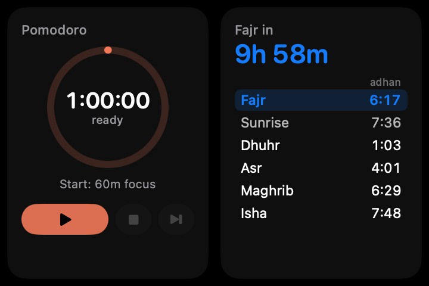
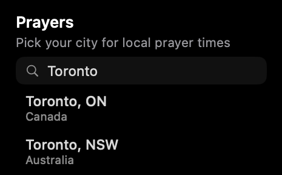
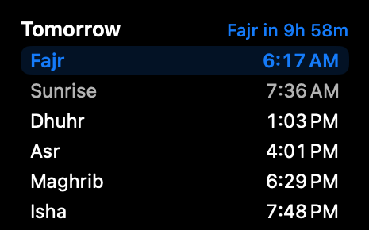
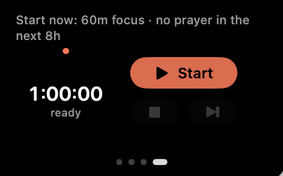

# Boring Notch — widgets edition

A fork of [Boring Notch](https://github.com/TheBoredTeam/boring.notch) that turns the
open notch into a small dashboard: **calendar, reminders, prayer times and a
prayer-aware Pomodoro timer**, side by side with the music player you already know.

It installs next to the official app (its own bundle id, settings and permissions),
so you can try it without giving anything up.

<p align="center">
  
</p>

## What it adds

### Swipeable widgets
The right side of the open notch is a pager: **Calendar · Reminders · Prayers ·
Pomodoro**. Swipe sideways with two fingers or click the dots. Every open starts on
the calendar. Each extra page can be switched off in Settings.

### Pull the notch down
Drag the strip along the bottom edge of the open notch (or click it, or scroll down
over the music side) and the notch grows to about twice its height. The music player
stays where it is, Pomodoro and prayer-time cards appear under it, and the calendar
(or reminders) runs the full height on the right. Drag up, click, scroll up or close
the notch to fold it back.

### Reminders
Incomplete reminders from the lists you pick, grouped as **Late**, **Today**, **Next
7 days** and **No date**, with list colours, priorities and due times. Tick one off
(with a moment to undo), click a title to open it in Reminders, or press **+** to add
one due today without leaving the notch.

### Prayer times
<p>
  
  
</p>

The first time you open the Prayers page it asks for your city, then shows the day's
times with a countdown to the next prayer. Times are calculated by the free
[AlAdhan API](https://aladhan.com/prayer-times-api) with the method most mosques in
your country use (ISNA in North America, Umm al-Qura in Saudi Arabia, Diyanet in
Türkiye, and so on); you can choose another method and the Hanafi Asr in Settings.
A month is fetched at a time and cached, so it keeps working offline.

Prefer your mosque's own timetable? Subscribe to a prayer-times calendar whose events
are named Fajr, Sunrise, Dhuhr, Asr, Maghrib and Isha (for example from
[prayerwebcal.dsultan.com](https://prayerwebcal.dsultan.com)); the widget uses it
automatically. Calendar events like `Isha at My Mosque · iqama 19:45` add iqama times.

### Prayer-aware Pomodoro


Press Start and the time until the next adhan is split into focus blocks as close to
your ideal length (60 minutes by default) as possible, with short breaks between them,
so the last block ends exactly when it's time to pray. Two and a half hours before
Asr becomes 2 × 70 minutes rather than 3 × 43. The plan is redone at every block, so
a late start or a long break just reshapes what's left. While a block runs, the closed
notch shows a small ring and the time remaining.

### Optional: FlowSavvy / FlowLocal
If you use the [FlowSavvy](https://flowsavvy.app) auto-scheduler (or FlowLocal), task
blocks on your calendar can get a checkbox: ticking one credits that sitting's time to
the task and lets the rest re-plan. This is **off unless you set it up** — it turns
itself on only if it finds a FlowSavvy key or a FlowLocal install — and with it off
the calendar is a plain Apple calendar. Settings › Calendar › Auto-scheduler
integration.

## Install

Requirements: macOS 15.6 or later, Xcode 26 or later.

```bash
git clone <this repository>
cd boring.notch
scripts/build-and-install.sh
```

This builds the app, installs it as `/Applications/Boring Notch (Custom).app` and
launches it. On first launch macOS asks for Calendar and Reminders access.

By default the build is signed ad hoc, so macOS asks for those permissions again after
every rebuild. To avoid that, create a local code-signing certificate and list it in
`~/.config/boring-notch/signing.env`; the top of
[`scripts/build-and-install.sh`](scripts/build-and-install.sh) explains how.

## Settings

Everything new lives in **Settings › Calendar**:

| Section | What it controls |
|---|---|
| Notch widgets | Show or hide the Reminders, Prayer times and Pomodoro pages |
| Prayer times | Source (automatic, calculated, calendar), city, calculation method, Asr |
| Pomodoro | Ideal block, short break, prayer break, align with prayers, sound |
| Reminders widget | Include reminders without a due date |
| Auto-scheduler integration | FlowSavvy key, FlowLocal status (optional) |

## Privacy

- Calendar and Reminders data stay on your Mac.
- Prayer times: your chosen city's coordinates are sent to api.aladhan.com once a
  month; the city search uses Apple Maps. Nothing is sent if you use a calendar
  instead.
- The FlowSavvy key, if you add one, is stored in the app's own sandbox container
  (readable only by the app and you) and only sent to my.flowsavvy.app.

## Working on the UI

`scripts/lab.sh` runs a hidden copy of the notch in a window behind the desktop
picture, driven by synthetic clicks, drags, scrolls and typing and captured with
`screencapture`. It never touches the real notch, never saves Pomodoro state and only
writes to Reminders when asked to. See the top of
[`boringNotch/extensions/NoorLab.swift`](boringNotch/extensions/NoorLab.swift) for the
commands.

## Tests

```bash
xcodebuild -project boringNotch.xcodeproj -scheme boringNotch test \
  CODE_SIGN_IDENTITY="-" CODE_SIGN_STYLE=Manual DEVELOPMENT_TEAM="" ENABLE_HARDENED_RUNTIME=NO
scripts/lab.sh build && scripts/lab-regression.sh
```

The unit tests (`boringNotchTests/WidgetsTests.swift` for this fork) cover the
Pomodoro planner, prayer-time parsing, iqama pairing and calculation-method choice. The
regression script drives the sandbox end to end: pulling down by drag, click and
scroll, the pages, reminders, and the prayer-location flow.

## Where the code is

| File | Feature |
|---|---|
| `extensions/HomeWidgets.swift` | Pager, pull-down, expanded cards |
| `extensions/RemindersWidget.swift` | Reminders page |
| `extensions/PrayerTimes.swift` | Prayer page and card, calendar parsing |
| `extensions/PrayerSources.swift` | AlAdhan times, city search, prayer settings |
| `extensions/Pomodoro.swift` | Pomodoro planner, pages and closed-notch timer |
| `extensions/TaskBlocks.swift` | Optional FlowSavvy / FlowLocal checkboxes |
| `extensions/NoorLab.swift` | UI sandbox |

## Credits and licence

Built on [Boring Notch](https://github.com/TheBoredTeam/boring.notch) by TheBoredTeam
(its original README is in [docs/UPSTREAM_README.md](docs/UPSTREAM_README.md)).
Prayer times by the [AlAdhan API](https://aladhan.com). Like the original, this fork
is licensed under the [GNU GPL v3](LICENSE).
